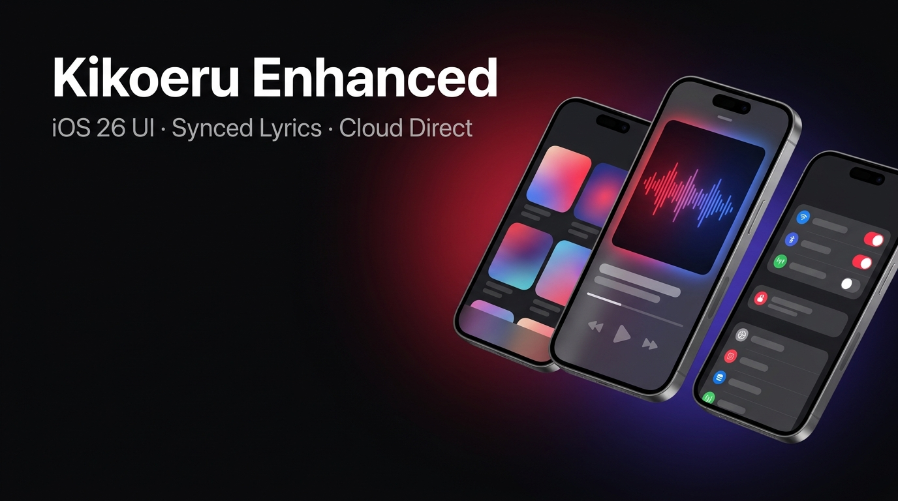
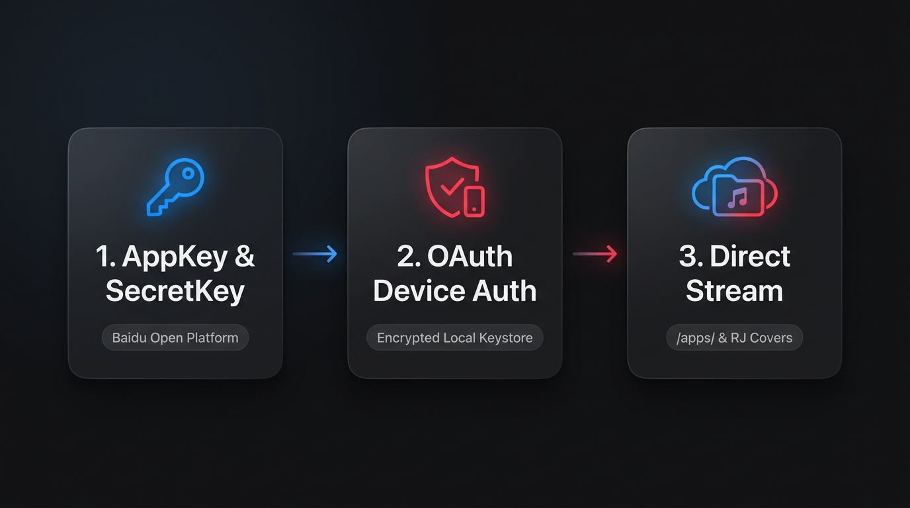

  

<h1 align="center">Kikoeru Android 魔改增强版</h1>

  基于 <a href="https://github.com/Zinhao/Kikoeru-android">Zinhao/Kikoeru-android</a>（GPL-3.0）二次开发 · 安装包前往 <a href="https://github.com/QAQMonika/Kikoeru-android-ios/releases">Releases 下载</a>

---

## 主要改动

- **三端合一作品页**：顶部切换 **在线 / 本地 / 网盘**，支持横向滑动，统一大图详情与双行音轨列表。
- **百度网盘直连，大幅省出手机空间**：无损音声单部动辄几百 MB 到数 GB，存在网盘里即可通过手机直连流式播放、读封面与挂字幕，不用整部下载占满手机存储，随时把本地空间腾出来。
- **iOS 26 UI + 新版设置页**：12 套深/浅色主题、液态玻璃/毛玻璃切换、左滑返回；底栏 **「更多 → 更多设置」** 采用卡片式分组，可找到账号切换、配色、记住播放位置与 **「仅加载有字幕作品」** 等开关。
- **逐句滚动模糊字幕**：20sp 居中高亮、非当前句渐进模糊、点按跳句、拖动 2.5 秒后自动回位。

---

## 百度网盘直连配置（保姆级教程）

  

> **为什么要自己配置密钥？** 本功能免电脑、免 NAS、免自建服务器，手机直接连接百度网盘官方接口，也不会在安装包里预置开发者私钥；你自己的密钥经手机 `AndroidKeyStore` 加密保存在本地，只供本人账号流式播放使用。

### 第一步：申请你自己的 `AppKey` 和 `SecretKey`

1. 浏览器打开 [百度网盘开放平台](https://pan.baidu.com/union/home)，点右上角登录你的百度账号（若提示需成为开发者，按页面指引完成个人实名认证即可）。
2. 登录后，点击页面右上角**头像旁边的「控制台」**入口，进入开发者控制台。
3. 在控制台点击 **「创建应用」**：
   - **应用名称**：起一个好记的名字（例如 `Kikoeru`）。创建成功后网盘里会自动对应一个专属目录 **`/apps/你的应用名称/`**。
   - **应用类别 / 描述**：类别选个人或软件工具类即可，描述随便写几字用途；**回调地址**可不填或保持默认（本软件采用设备码授权，无需配置回调页面）。
4. 提交创建后，打开刚建立的应用详情页，复制记下 **`AppKey`** 和 **`SecretKey`**。  
   > ⚠️ **注意区分**：要复制 **`AppKey`** 和 **`SecretKey`**，**不要填成数字的 `AppID`**，也不用管 `SignKey`。
5. **提前放好作品文件夹**：百度个人应用默认通常只开放读写 **`/apps/你的应用名称/`** 专属目录（无全盘权限时不能读根目录）。把你要听的音声文件夹提前放进百度网盘里的 **`/apps/你的应用名称/`** 下即可。

### 第二步：在手机 App 里绑定与选目录

1. 打开 App，在首页顶部 **「在线 / 本地 / 网盘」** 中切换到 **「网盘」**。
2. 点击页面上的 **「配置应用」** 按钮（已连接后如需修改，可在网盘页点底栏右下角 **「更多」 → 「应用配置」**）。
3. 填入刚拿到的 **`AppKey`** 和 **`SecretKey`**，点击 **「保存」**。
4. 弹窗显示 **「授权码：XXXXXX」** 后，点击 **「打开百度授权」**：
   - 在弹出的百度官方网页里登录你的百度账号，输入授权码并点击同意授权；
   - 授权完成后**直接切回 Kikoeru App** 等待几秒，页面会自动绑定成功并显示你的网盘昵称。
5. 点击 **「选择作品目录」**：
   - **个人应用（推荐直接用这招）**：选 **「直接输入路径」**，输入 **`/apps/你刚才创建的应用名称`**（例如 `/apps/Kikoeru`）确认即可进入。
   - **已有全盘读取权限**：选 **「浏览文件夹」**，一层层点进放作品的目录，然后点 **「使用此目录」**。

### 第三步：用网盘省空间的实用玩法 & 摆放规范

- **腾出手机本地空间**：在顶部切到 **「本地」** → 长按本地作品文件夹 → **「上传到百度网盘」**（会先校验再按 4 MiB 分片复制到网盘）；传完确认网盘能正常播放后，就能删掉本地大体积原文件，省下大量手机存储。
- **解压后再传网盘**：本版直接在线流式播音频，**不支持直接读取 `.zip`/`.rar` 压缩包**。
- **文件夹名带 `RJ` 编号**：如 `RJ01544069 作品名`，会自动补全标签、CV、社团信息，并在缺失封面或遇到百度和谐占位图时自动拉取官方原版封面。
- **封面与字幕规则**：
  - 封面优先读目录内独立图片（`cover`/`folder`/`封面` 等，向下最多扫 4 层、最大 48 MB），其次读 WAV/FLAC/MP3/M4A 内嵌封面（最大 16 MB），最后回退 RJ 官方封面。
  - `.lrc` / `.vtt` 字幕与音频放在同一目录且主文件名相同即可加载（同时存在时优先 `.lrc`）。

更多接口与排错细节见 [BAIDU.md](work/subtitle-follow/BAIDU.md)。

---

## 构建与版本

- 当前版本：`fix31`（SHA-256：`DC14F0E02130D38354A9E77F30C6439E46B5C12D4BF0EC8E21CE02C45AC326CA`，1,690 项检查通过）
- 历史改动：[CHANGELOG.md](CHANGELOG.md)
- 开源协议：[LICENSE](LICENSE)（GNU GPL-3.0）
